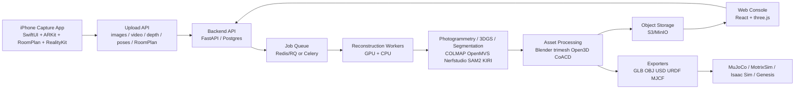

# iPhone 扫描重建到机器人仿真平台方案

## 结论

这个需求可以做成真实可用的平台，但不能把“好看的 3D 扫描”和“机器人仿真可用资产”混为一件事。

推荐方案是：`iPhone 原生采集 App + Web 控制台 + 后端重建/处理流水线 + 仿真导出器`。Web 控制台负责 B/S 侧的项目、任务、预览、质检和导出；iPhone App 负责 ARKit、RoomPlan、LiDAR、Object Capture 这些浏览器拿不到或拿不稳的能力。纯 Safari/PWA 只能作为低配入口，用于拍照/录像上传，不能作为高质量 LiDAR/RoomPlan 扫描主链路。

最终输出不要只做一个 `glb`。要输出一套仿真包：

1. `visual.glb` / `visual.obj`：高模视觉资产，带贴图。
2. `collision.obj` / `collision.stl`：简化碰撞网格或凸分解结果。
3. `asset.json`：尺度、类别、质量、摩擦、材质、坐标系、来源、置信度。
4. `scene.json`：场景布局、物体实例、pose、语义、层级。
5. `scene.xml` / MJCF：给 MuJoCo 和 MotrixSim。
6. `scene.urdf`：给 URDF 兼容链路。
7. `scene.usd` / `scene.usdz`：给 Isaac Sim / Omniverse / AR 预览。

其中 3DGS/NeRF 可以做高保真视觉层，但不能直接当物理仿真碰撞体；机器人仿真必须有 mesh、尺度、质量、惯性、摩擦和 collision geometry。

## 两个功能拆分

### 1. 资产扫描

目标：扫描一个独立物体，比如瓶子、杯子、盒子、零件，生成细致 3D 模型和材质。

推荐采集方式：

1. iPhone App 使用 `ObjectCaptureSession` 做引导式拍摄。
2. 对普通非反光物体，用 Apple Object Capture 或服务端 COLMAP/OpenMVS 重建 mesh。
3. 对透明、反光、低纹理物体，用 KIRI Engine 的 Featureless Object Scan / 3DGS to Mesh 作为商业 API fallback。
4. 对要求最高的资产，增加受控采集：转台、均匀灯光、背景板、标尺、可选偏振片。

资产扫描的真实边界：

1. 普通 iPhone 照片可以恢复几何和颜色贴图，但很难精确测量 PBR 材质参数。
2. 透明瓶子、金属高光、黑色亮面、玻璃、纯白无纹理物体是 photogrammetry 难点。
3. “材质很细致”可以做到视觉上接近，但 `roughness`、`metallic`、`normal`、`specular` 多数是推断或生成，不是严格物理测量。
4. 仿真里真正重要的是：尺度、碰撞体、质量、惯性、摩擦、抓取接触面；视觉贴图只是给相机观测和渲染用。

资产处理流水线：

```text
iPhone guided capture
  -> upload images/video/depth/poses
  -> quality check: blur, exposure, overlap, coverage, scale marker
  -> mask foreground object
  -> reconstruction: Object Capture / COLMAP+OpenMVS / KIRI API / 3DGS-to-mesh
  -> mesh cleanup: remove floaters, fill holes, decimate, remesh, UV unwrap
  -> texture bake: albedo-like texture, optional normal/roughness estimation
  -> scale alignment: LiDAR/ARKit scale or marker scale
  -> collision generation: primitive fit + CoACD/V-HACD convex decomposition
  -> physical metadata: category, mass, density, friction, inertia estimate
  -> export: GLB, OBJ, USDZ, MJCF, URDF, manifest
```

### 2. 场景扫描

目标：扫描一个房间、工位、桌面、实验区、仓库角落，重建整体场景，并尽量把场景和资产分离。

推荐采集方式：

1. iPhone Pro / iPad Pro 用 ARKit LiDAR mesh 获取实时尺度和粗几何。
2. RoomPlan 获取墙、门、窗、地面、家具类型、尺寸和布局。
3. 同步采集 RGB 视频、相机 pose、深度、ARMeshAnchor、RoomPlan JSON/USD。
4. 服务端再训练或重建 3DGS/NeRF，得到高保真视觉场景。
5. 用 RoomPlan 语义框 + SAM2/Grounded-SAM mask + RGB-D 投影，把物体实例从场景中分离出来。

场景输出分两层：

1. `metric scene layer`：RoomPlan/ARKit 生成的可测量几何、地面、墙面、家具 bounding boxes、坐标系。
2. `visual scene layer`：mesh 或 3DGS，负责视觉真实感。
3. `simulation layer`：地面/墙体/桌面用稳定 primitive 或简化 mesh；可交互物体用独立资产包。

场景处理流水线：

```text
iPhone room/scene scan
  -> upload RGB video + depth + camera poses + ARKit mesh + RoomPlan result
  -> scene quality check: loop closure, tracking lost, exposure, coverage
  -> metric reconstruction: room planes, floor, table, shelves, obstacles
  -> visual reconstruction: 3DGS/NeRF or textured mesh
  -> object proposals: RoomPlan categories + Grounded-SAM/SAM2 masks
  -> 2D mask tracking across frames
  -> lift masks to 3D using depth/pose
  -> cluster per-object points / mesh faces / gaussians
  -> extract assets and residual static scene
  -> generate scene.json layout and per-object pose
  -> export to MJCF/URDF/USD package
```

## 自动分离资产和场景

可以做，但要定义成“自动分离 + 人工校正”，不能承诺 100% 全自动。

推荐算法组合：

1. RoomPlan：先拿墙、门、窗、家具类型、家具 3D boxes。
2. Grounded-SAM / Grounded-SAM2：根据类别文本自动检测并分割，比如 `bottle . cup . table . chair`。
3. SAM2：对视频里同一物体做 mask tracking。
4. RGB-D lifting：用每帧 depth + camera pose 把 mask 投到 3D 点云或 mesh。
5. 3D clustering：DBSCAN / connected components / graph cut，把同一物体聚合。
6. Mesh face labeling：把 2D mask 票投到 mesh face，生成 per-object mesh。
7. QA UI：Web 端允许点选、合并、拆分、重命名、重新分割。

分离策略：

1. 独立小物体：优先当 asset，单独重建、单独导出。
2. 大件家具：可作为 scene prop，也可抽成 asset；取决于是否要机器人交互。
3. 墙、地、门、窗、固定柜体：作为 scene geometry。
4. 桌面、货架、台面：作为可放置 surface，优先生成稳定 collision primitive。
5. 透明/反光物：不要只靠 mask，最好单独走资产扫描模式。

## 推荐 B/S 架构



### 移动端

1. SwiftUI 原生 App，不建议纯 Web 起步。
2. Asset mode：
   - ObjectCaptureSession 引导用户绕物体拍摄。
   - 采集照片、相机内参、可选 LiDAR 深度、尺度提示。
3. Scene mode：
   - ARKit world tracking。
   - Scene reconstruction mesh。
   - RoomPlan scan。
   - RGB 视频和关键帧。
4. Capture QA：
   - 模糊检测、曝光检测、覆盖角度、跟踪丢失提示。
   - 标尺/AR ruler 校验真实尺度。

### Web 端

1. 项目/任务管理。
2. 扫描包上传、队列状态、失败原因。
3. three.js 预览：mesh、texture、collision、RoomPlan layout、3DGS preview。
4. 分割校正：点击物体、合并/拆分、重命名类别、重新生成。
5. 仿真导出：选择 MuJoCo、MotrixSim、Isaac Sim、Genesis。
6. 质检面板：尺度、面数、贴图大小、collision hull 数量、watertight、物理参数。

### 后端

推荐技术：

1. API：FastAPI。
2. DB：Postgres；MVP 可 SQLite，但生产建议 Postgres。
3. 存储：S3/MinIO，按 `project/task/artifacts` 分层。
4. 队列：Redis + RQ/Celery。
5. GPU worker：NVIDIA GPU，跑 Nerfstudio/3DGS/SAM2。
6. CPU worker：COLMAP/OpenMVS/Blender/trimesh/Open3D/CoACD。
7. 第三方重建：KIRI API 作为商业 fallback，不要让它成为唯一链路。

## 仿真导出设计

### MuJoCo / MotrixSim

MuJoCo 使用 MJCF XML，mesh asset 可以被 geom 引用；MotrixSim 文档说明它高度兼容 MJCF。导出策略：

```xml
<mujoco model="scanned_scene">
  <asset>
    <mesh name="bottle_visual" file="assets/bottle_visual.obj"/>
    <mesh name="bottle_collision" file="assets/bottle_collision.obj"/>
  </asset>
  <worldbody>
    <geom name="floor" type="plane" size="5 5 0.05" friction="0.8 0.1 0.1"/>
    <body name="bottle" pos="0.3 0.1 0.85" quat="1 0 0 0">
      <freejoint/>
      <inertial mass="0.08" pos="0 0 0" diaginertia="0.0001 0.0001 0.0001"/>
      <geom name="bottle_col" type="mesh" mesh="bottle_collision" contype="1" conaffinity="1" friction="0.6 0.1 0.1"/>
      <geom name="bottle_vis" type="mesh" mesh="bottle_visual" contype="0" conaffinity="0" rgba="1 1 1 1"/>
    </body>
  </worldbody>
</mujoco>
```

实际导出时要把 `visual` 和 `collision` 分开：高模视觉 mesh 不参与碰撞，低模/凸分解 mesh 参与碰撞。

### Isaac Sim

Isaac Sim 主链路是 USD。可以从 URDF 导入并转 USD，也可以直接生成 USD stage。推荐导出：

1. `scene.usd`：完整场景。
2. `assets/*.usd`：独立资产。
3. `textures/*`：PBR/贴图。
4. `physics` metadata：mass、collider、material、friction。

### Genesis / 其他 ML 管线

输出一个统一 `manifest.json`，让不同 simulator adapter 读取：

```json
{
  "unit": "meter",
  "up_axis": "z",
  "assets": [
    {
      "id": "bottle_001",
      "category": "bottle",
      "visual_mesh": "assets/bottle_visual.glb",
      "collision_mesh": "assets/bottle_collision.obj",
      "mass_kg": 0.08,
      "friction": 0.6,
      "pose": {"position": [0.3, 0.1, 0.85], "quaternion": [1, 0, 0, 0]},
      "confidence": {"geometry": 0.82, "material": 0.55, "physics": 0.45}
    }
  ]
}
```

## 技术选型

| 模块 | 首选 | 备用 / 补充 | 说明 |
|---|---|---|---|
| iPhone 资产采集 | RealityKit Object Capture | KIRI API / Polycam 手工导出 | Apple 适合自研闭环，KIRI 适合快速商业 API |
| iPhone 场景采集 | ARKit + RoomPlan | Polycam / Scaniverse 手工导出 | RoomPlan 有尺度和语义，第三方适合验证效果 |
| 普通 mesh 重建 | COLMAP + OpenMVS | Apple Object Capture | 开源可控，速度和稳定性需要工程调参 |
| 高保真视觉场景 | Nerfstudio / 3DGS | KIRI 3DGS Scan | 视觉真实，但不是物理碰撞资产 |
| 自动分割 | Grounded-SAM2 + SAM2 | RoomPlan boxes + manual QA | 必须保留人工校正 |
| Mesh 清理 | Blender + trimesh + Open3D | MeshLab / PyMeshLab | 修洞、简化、重拓扑、UV、贴图 |
| 碰撞体 | primitive fit + CoACD/V-HACD | simplified triangle mesh | 仿真稳定优先于视觉精细 |
| MuJoCo/MotrixSim | MJCF | URDF -> converter | MotrixSim 兼容 MJCF，优先 MJCF |
| Isaac Sim | USD | URDF import to USD | USD 更适合场景和材质 |

## 真实可用落地顺序

### 第一版：先跑通闭环

1. iPhone App 支持 asset mode 和 scene mode。
2. 上传照片/视频/depth/pose/RoomPlan 到后端。
3. 资产模式先用 Apple Object Capture 或 KIRI API 出 mesh。
4. 场景模式先用 RoomPlan + ARKit mesh 出场景骨架。
5. 后端生成 GLB/OBJ、collision OBJ、MJCF、URDF、manifest。
6. Web 端能预览 visual/collision/scene 三个视图。
7. MuJoCo 和 MotrixSim 能加载一个瓶子 + 桌面 + 地面场景。

### 第二版：增强自动分离

1. 引入 Grounded-SAM2/SAM2。
2. RoomPlan 3D boxes 和 2D masks 融合。
3. 支持用户在 Web 端修正分割。
4. 对每个 extracted object 单独生成资产包。
5. 支持“场景残留 mesh + 独立可交互资产”组合导出。

### 第三版：提高细节和材料

1. 受控灯光和转台采集。
2. 3DGS visual layer。
3. 贴图 delight / normal / roughness 估计。
4. 物理属性库：按类别给质量、密度、摩擦先验。
5. 自动质量检查失败后重试或提示补拍。

## 质检标准

资产级：

1. 尺度误差：普通物体控制在 2-5 cm 以内；有标尺时争取 1-2 cm。
2. visual mesh：无明显缺面、漂浮碎片、贴图错位。
3. collision mesh：面数低、稳定、不穿地、不爆炸。
4. 材质：贴图清晰；PBR 参数必须标记为 `estimated` 或 `measured`。
5. 导入测试：MuJoCo/MotrixSim 加载不报错，Isaac Sim/three.js 可预览。

场景级：

1. 地面水平、尺度正确、墙/门/桌面位置可用。
2. 关键物体能分离成独立 asset 或标为不可交互 scene prop。
3. scene.json 中每个 object 都有 pose、scale、category、source。
4. collision 场景能跑基本接触测试：机器人/物体不穿地，桌面可承托。
5. 视觉层和物理层坐标对齐。

## 风险和限制

1. 纯 B/S 浏览器方案不适合高质量 iPhone 扫描主链路；ARKit、RoomPlan、LiDAR mesh 需要原生 App。
2. 自动分离不可能一次全对，必须有 Web QA 修正。
3. 透明、反光、无纹理物体是最大难点，瓶子如果是透明塑料或玻璃，建议单独资产模式 + KIRI Featureless/3DGS fallback + 人工质检。
4. 3DGS 视觉非常好，但不是 watertight mesh，不能直接用于碰撞、质量、惯性。
5. PBR 材质从普通手机照片中只能估计；如果要真实物理材质，需要受控光照、偏振、材质库或人工标注。
6. 仿真导出不是格式转换那么简单，必须生成 collision mesh、尺度、惯性、摩擦，否则导入成功也不能稳定用于机器人学习。
7. 云端重建会涉及隐私和数据合规，室内场景尤其要支持本地部署或私有化存储。

## 推荐方案

最实用的产品方案：

1. 自研 iPhone 采集 App，保证 capture 数据可控。
2. 自研 B/S Web 控制台和后端任务系统。
3. 第一版资产重建接 Apple Object Capture / KIRI API，避免早期卡死在重建质量上。
4. 场景重建以 RoomPlan/ARKit metric layer 为核心，3DGS 只作为视觉增强。
5. 仿真导出以 MJCF 为第一目标，兼容 MuJoCo 和 MotrixSim；同时产出 URDF/USD。
6. 所有输出都强制区分 `visual asset`、`collision asset`、`semantic layout`、`physics metadata`。

如果要对接已有 Real2Motrix，建议沿用当前包结构：`scene.xml`、`scene.urdf`、`scene.json`、visual mesh、collision mesh、metadata/report、zip package。这样可以把这次方案直接变成 Real2Motrix 的产品化升级，而不是另起炉灶。

## 资料来源

1. Apple RealityKit Object Capture: https://developer.apple.com/documentation/realitykit/realitykit-object-capture
2. Apple RoomPlan overview: https://developer.apple.com/augmented-reality/roomplan/
3. Apple RoomPlan ML research: https://machinelearning.apple.com/research/roomplan
4. Apple ARKit scene reconstruction: https://developer.apple.com/documentation/arkit/visualizing-and-interacting-with-a-reconstructed-scene
5. COLMAP documentation: https://colmap.readthedocs.io/
6. OpenMVS repository: https://github.com/cdcseacave/openMVS
7. Nerfstudio export geometry: https://docs.nerf.studio/quickstart/export_geometry.html
8. 3D Gaussian Splatting paper: https://arxiv.org/abs/2308.04079
9. Meta SAM2: https://ai.meta.com/research/sam2/
10. Grounded-Segment-Anything: https://github.com/IDEA-Research/Grounded-Segment-Anything
11. KIRI Engine API: https://www.kiriengine.app/api
12. KIRI export formats: https://www.kiriengine.app/faq/what-kind-of-file-formats-can-kiri-engine-export
13. Polycam export formats: https://learn.poly.cam/hc/en-us/articles/27756102599572-What-File-Types-Can-Polycam-Export
14. MuJoCo XML reference: https://mujoco.readthedocs.io/en/3.3.3/XMLreference.html
15. MotrixSim documentation: https://motrixsim.readthedocs.io/
16. Isaac Sim URDF import: https://docs.isaacsim.omniverse.nvidia.com/latest/importer_exporter/import_urdf.html
