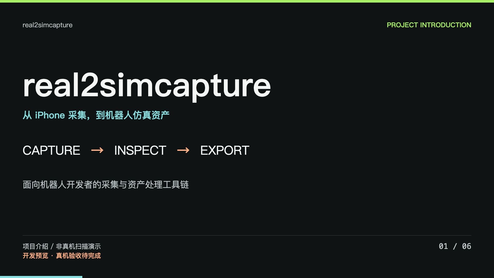

# real2simcapture

面向机器人开发者的 iPhone 采集与仿真资产处理工具链。

[English](README.md) · [安装与真机操作](docs/SETUP.md) · [当前发布状态](docs/launch/READINESS.zh-CN.md) · [贡献指南](CONTRIBUTING.md)

**当前为开发预览。** 已有原生采集代码、Live 网格传输、Web 三维查看、处理与导出。完整 iPhone 采集到仿真运行仍需硬件验收；测试输入不作为真实扫描演示。

约 62 秒横竖版介绍片、字幕及多平台文案见[视频交付说明](docs/launch/PUBLISHING.zh-CN.md)。实现位于私有仓库的 `codex/open-source-preview` 分支，尚未合入 main 或正式公开。

## Live 链路

ARKit 在手机上生成场景网格，App 以约两秒间隔尝试上传最新快照，Web 轮询网格版本并显示实际三维几何。更新频率受网络、性能与跟踪状态影响，不是固定实时性保证。

RGB-D 帧顺序上传，队列有界；积压帧保留在手机本地，结束前补传。后端串行写入、原子替换文件，重试结束请求不会重复创建任务。当前不承诺 App 被终止后的恢复。

高质量贴图重建、语义处理和最终仿真包生成是独立后续步骤。估算的质量、摩擦和材质参数需要校正或测量。

## 安装

需要 Python 3.11+、Node.js 22+，后端支持 macOS/Linux。按[安装指南](docs/SETUP.md)启动工作站，用完整 Xcode 构建工程并安装到支持 LiDAR 的 iPhone。

API 没有应用层认证，仅适合本机或受控网络开发，不应直接向公网开放。

## 验证与贡献

自动测试覆盖实际代码及 HTTP 路径；程序生成的几何仅是回归夹具。iOS 编译、真机采集和引擎运行分别记录，不互相替代。外部工具不可用时报告失败，不生成虚假结果。未实测前不承诺厘米级精度、秒级重建或生产可用。

详见[贡献指南](CONTRIBUTING.md)、[历史架构](docs/ARCHITECTURE.zh-CN.md)与[第三方说明](THIRD_PARTY.md)。项目公开授权和许可证仍待权利人确认。
